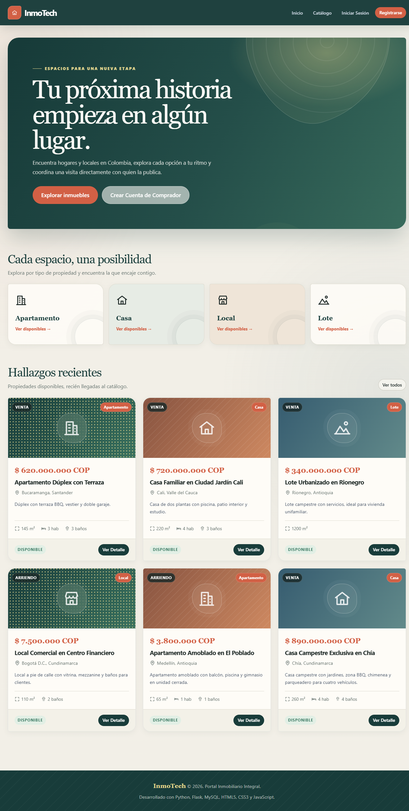
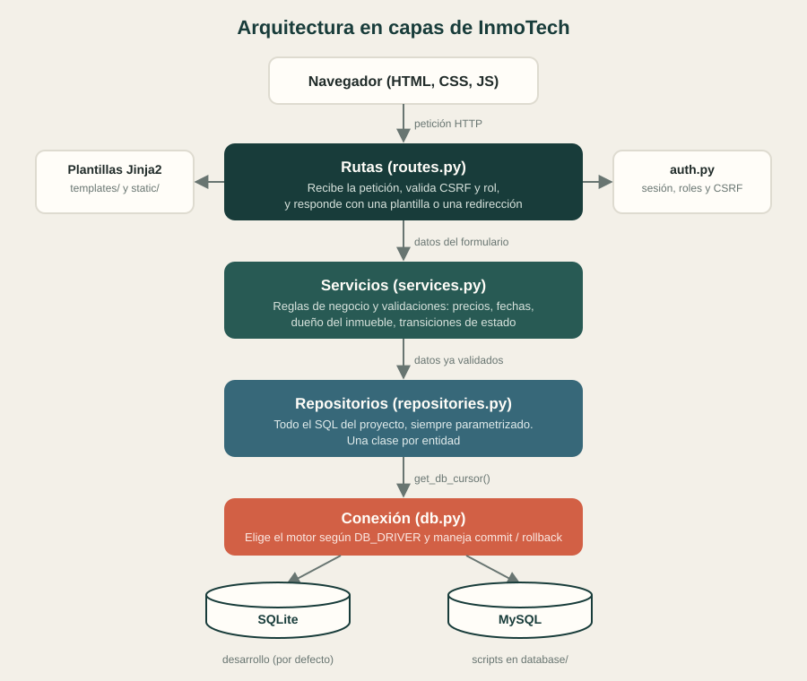
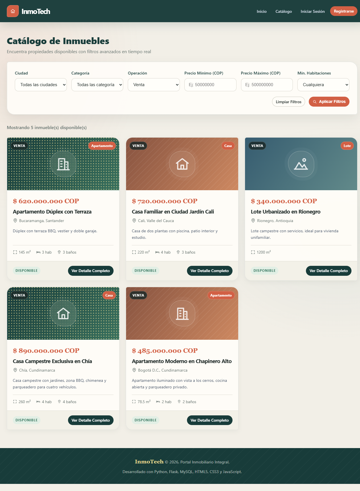
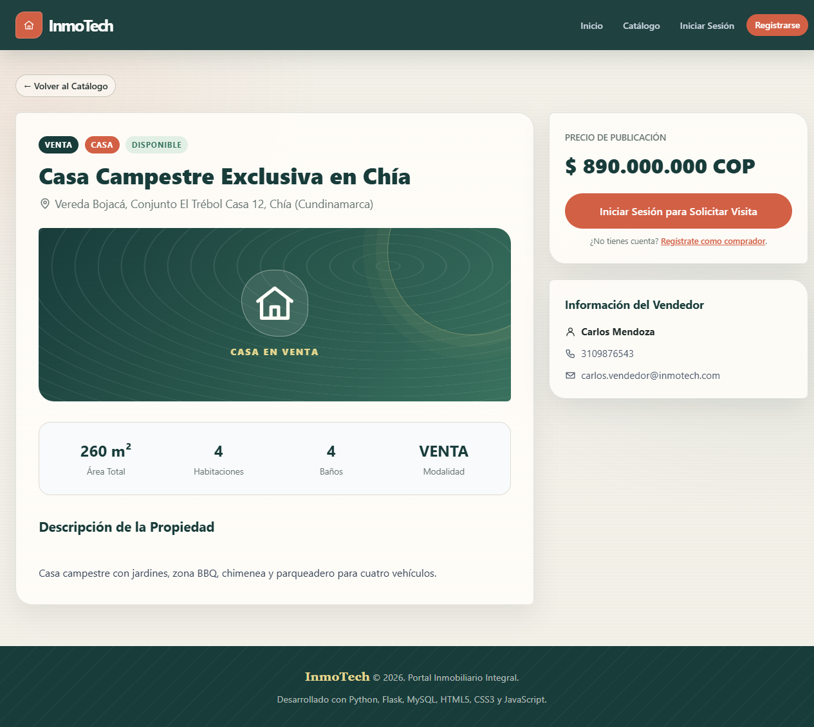
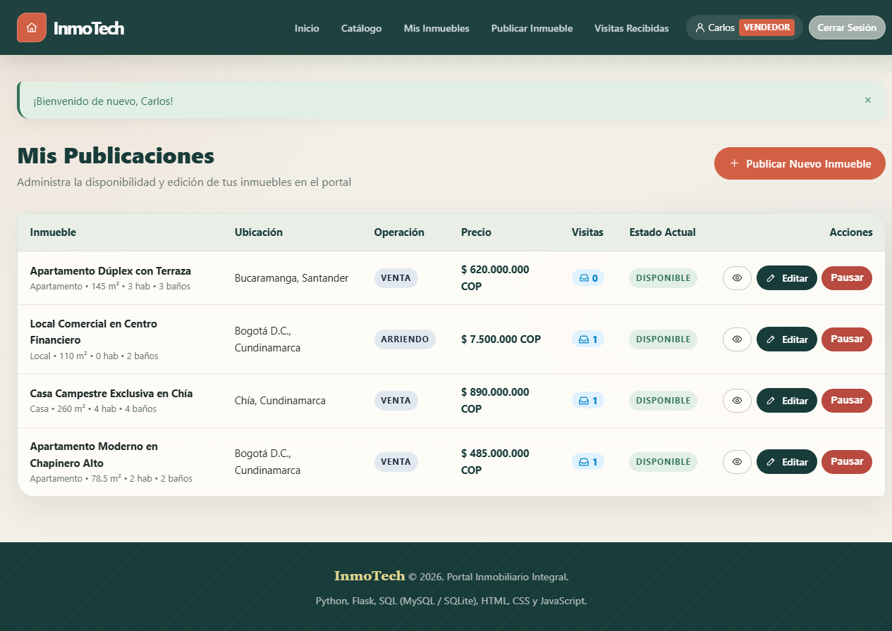
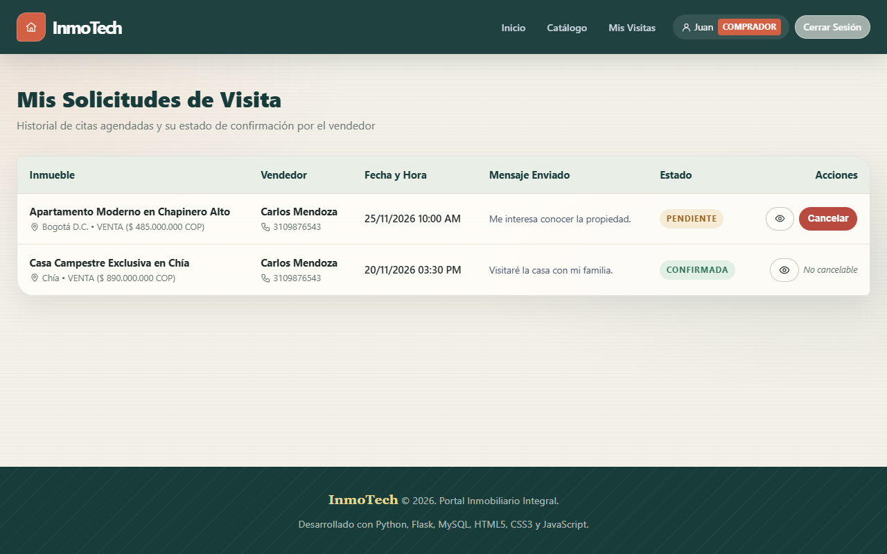

# InmoTech

Portal inmobiliario web para publicar, buscar y visitar inmuebles en Colombia. Hace parte del proyecto integrador y está construido con Python, Flask y SQL.

Un **vendedor** publica casas, apartamentos, lotes y locales; un **comprador** los busca con filtros y pide una visita; el vendedor confirma o rechaza esa visita. Todo el recorrido está cubierto: registro, inicio de sesión, catálogo, publicación, edición, agenda de visitas.



## Contenido

- [Qué hace](#qué-hace)
- [Tecnologías](#tecnologías)
- [Cómo ejecutarlo](#cómo-ejecutarlo)
- [Estructura del proyecto](#estructura-del-proyecto)
- [Documentación](#documentación)
- [Pantallas](#pantallas)
- [Pendientes y mejoras](#pendientes-y-mejoras)

## Qué hace

| Rol | Puede |
|---|---|
| Visitante | Ver el inicio, explorar el catálogo con filtros, abrir el detalle de un inmueble, registrarse |
| Comprador | Todo lo anterior, pedir una visita a un inmueble disponible y cancelar sus solicitudes pendientes |
| Vendedor | Publicar inmuebles, editarlos, pausarlos o reactivarlos y gestionar las visitas que le llegan |
| Administrador | Existe en la base de datos, todavía no tiene pantallas propias |

El catálogo se puede filtrar por ciudad, categoría, operación (venta o arriendo), rango de precio y mínimo de habitaciones. Los precios se muestran en pesos colombianos.

## Tecnologías

- **Python 3** y **Flask 3** (rutas, sesiones, plantillas Jinja2)
- **SQLite** para desarrollar y **MySQL** como motor del proyecto (`mysql-connector-python`)
- **Werkzeug** para el hash de contraseñas
- **python-dotenv** para la configuración
- HTML, CSS y JavaScript sin frameworks; iconos propios en SVG

## Cómo ejecutarlo

Requisitos: Python 3.10 o superior.

```bash
python -m venv .venv
.venv\Scripts\activate
pip install -r requirements.txt
copy .env.example .env
python run.py
```

Después abre <http://127.0.0.1:5000>.

La primera vez que arranca, la aplicación crea el archivo `instance/inmotech.sqlite3` con las tablas y los datos de prueba. No hay que instalar ningún servidor de base de datos.

### Cuentas de prueba

La clave de todas es `123456`.

| Rol | Correo |
|---|---|
| Vendedor | carlos.vendedor@inmotech.com |
| Vendedor | maria.vendedora@inmotech.com |
| Comprador | juan.comprador@gmail.com |
| Comprador | laura.compradora@gmail.com |
| Administrador | admin@inmotech.com |

### Usar MySQL

1. Ejecuta en orden `database/01_estructura.sql` y `database/02_datos_iniciales.sql`.
2. En el `.env` cambia `DB_DRIVER=mysql` y completa `DB_HOST`, `DB_USER`, `DB_PASSWORD` y `DB_NAME`.
3. Reinicia la aplicación.

El detalle está en [docs/base-de-datos.md](docs/base-de-datos.md).

## Estructura del proyecto

```
InmoTech/
├── run.py                    punto de entrada
├── requirements.txt
├── .env.example              plantilla de configuración
├── app/
│   ├── __init__.py           create_app(), filtros de plantilla, páginas de error
│   ├── routes.py             rutas HTTP (controladores)
│   ├── services.py           reglas de negocio y validaciones
│   ├── repositories.py       todo el SQL de la aplicación
│   ├── db.py                 conexión y transacciones (SQLite / MySQL)
│   ├── auth.py               sesión, roles y protección CSRF
│   ├── templates/            base.html y las 10 páginas
│   └── static/
│       ├── css/              styles.css, theme.css, icons.css
│       ├── js/main.js
│       └── img/              favicon e iconos SVG
├── database/
│   ├── 01_estructura.sql     tablas, llaves e índices (MySQL)
│   ├── 02_datos_iniciales.sql
│   ├── 03_consultas.sql      consultas de referencia
│   └── sqlite/               los mismos scripts adaptados a SQLite
├── docs/                     documentación y diagramas
└── instance/                 base SQLite local (no se sube a git)
```



## Documentación

| Documento | De qué trata |
|---|---|
| [Arquitectura](docs/arquitectura.md) | Capas, responsabilidades de cada archivo, rutas y recorrido de una petición |
| [Base de datos](docs/base-de-datos.md) | Diseño, modelo entidad-relación, diccionario de datos, scripts y cómo la usa la aplicación |
| [Guía de uso](docs/guia-de-uso.md) | Qué hace cada rol, pantalla por pantalla, y el ciclo de vida de una visita |
| [Seguridad](docs/seguridad.md) | Contraseñas, CSRF, sesiones, control de acceso y SQL parametrizado |

## Pantallas

| | |
|---|---|
|  |  |
| Catálogo con filtros | Detalle de un inmueble |
|  |  |
| Panel del vendedor | Solicitudes del comprador |

En la [guía de uso](docs/guia-de-uso.md) están todas.

## Pendientes y mejoras

- Pantallas para el rol administrador (la consulta de estadísticas ya existe en `database/03_consultas.sql`).
- Fotos de los inmuebles: hoy cada tarjeta muestra un icono según la categoría.
- Límite de intentos en el inicio de sesión.
- Pruebas automáticas.
- Reutilizar conexiones a la base de datos en vez de abrir una por consulta.
