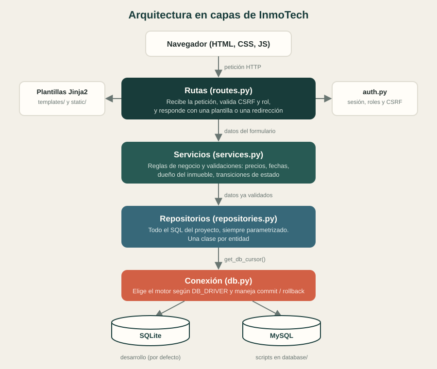
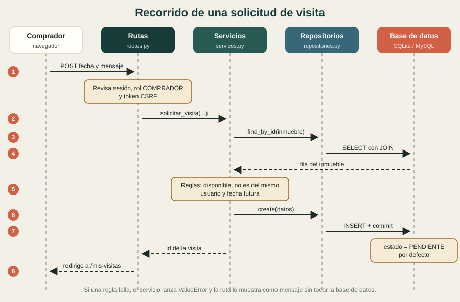

# Arquitectura

InmoTech es una aplicación Flask organizada en capas. Cada capa hace una sola cosa y solo le habla a la que tiene debajo.

## Por qué capas

La primera versión de cualquier proyecto suele mezclar todo en las rutas: validar el formulario, armar el SQL y devolver el HTML en la misma función. Funciona, pero cualquier cambio obliga a tocar todo. Separar en capas nos permite:

- **Cambiar la base de datos sin tocar las reglas.** De hecho lo hicimos: el proyecto corre en SQLite y en MySQL con el mismo código de negocio.
- **Encontrar rápido dónde está cada cosa.** Si falla una validación se busca en `services.py`; si falla una consulta, en `repositories.py`.
- **Probar cada capa por separado**, porque los servicios no dependen de Flask ni las rutas de SQL.

## Responsabilidad de cada archivo

| Archivo | Capa | Qué hace | Qué no debe hacer |
|---|---|---|---|
| `app/routes.py` | Presentación | Lee la petición, llama al servicio, devuelve plantilla o redirección, muestra mensajes | Validar reglas de negocio, escribir SQL |
| `app/services.py` | Negocio | Valida datos, aplica reglas (fecha futura, dueño del inmueble, transiciones de estado) y lanza `ValueError` o `PermissionError` | Conocer Flask, escribir SQL |
| `app/repositories.py` | Datos | Contiene todo el SQL, una clase por entidad (`UsuarioRepository`, `InmuebleRepository`, `VisitaRepository`, `UbicacionCategoriaRepository`) | Tomar decisiones de negocio |
| `app/db.py` | Infraestructura | Abre la conexión, elige el motor, hace commit o rollback | Contener consultas de la aplicación |
| `app/auth.py` | Transversal | Guarda y lee la sesión, decoradores de rol, token CSRF | — |
| `app/__init__.py` | Arranque | `create_app()`: configuración, filtros de plantilla (`cop`, `fecha`), iconos, páginas de error | — |
| `app/templates/` | Presentación | HTML con Jinja2; todas heredan de `base.html` | Lógica de negocio |

## Cómo viaja una petición

Ejemplo: un comprador pide una visita.

1. El navegador envía el formulario por `POST`.
2. La ruta comprueba sesión, rol y token CSRF (`@role_required`, `validate_csrf`).
3. Llama a `VisitaService.solicitar_visita(...)`.
4. El servicio consulta el inmueble a través del repositorio y aplica las reglas: que exista, que esté disponible, que el comprador no sea el dueño y que la fecha sea futura.
5. Si todo está bien, el repositorio inserta la visita con estado `PENDIENTE` y hace commit.
6. La ruta redirige a `/mis-visitas` con un mensaje de éxito. Si una regla falló, el servicio lanzó `ValueError` y la ruta lo muestra como mensaje, sin haber tocado la base de datos.

## Rutas

| Método | Ruta | Quién | Función |
|---|---|---|---|
| GET | `/` | Todos | Inicio con categorías y últimos inmuebles |
| GET | `/catalogo` | Todos | Catálogo con filtros por query string |
| GET | `/inmuebles/<id>` | Todos | Detalle de un inmueble |
| GET, POST | `/login` | Todos | Inicio de sesión |
| GET, POST | `/registro` | Todos | Registro de comprador |
| GET | `/logout` | Todos | Cierra la sesión |
| GET, POST | `/inmuebles/nuevo` | Vendedor | Publicar inmueble |
| GET, POST | `/inmuebles/<id>/editar` | Vendedor dueño | Editar inmueble |
| POST | `/inmuebles/<id>/cambiar-estado` | Vendedor dueño | Pausar o reactivar |
| GET | `/mis-inmuebles` | Vendedor | Sus publicaciones |
| GET, POST | `/inmuebles/<id>/solicitar-visita` | Comprador | Pedir una visita |
| GET | `/mis-visitas` | Comprador | Sus solicitudes |
| POST | `/mis-visitas/<id>/cancelar` | Comprador dueño | Cancelar una solicitud pendiente |
| GET | `/visitas-recibidas` | Vendedor | Visitas a sus inmuebles |
| POST | `/visitas-recibidas/<id>/cambiar-estado` | Vendedor dueño | Confirmar, rechazar o marcar realizada |
| GET | `/api/ciudades/<id_departamento>` | Todos | JSON con las ciudades de un departamento (lo usa el formulario de publicar) |

## Decisiones de diseño

**Repositorios con métodos estáticos.** Cada consulta es un método con nombre propio (`find_by_vendedor`, `update_estado`). Las rutas y servicios nunca arman SQL.

**Errores como excepciones.** Los servicios lanzan `ValueError` cuando el dato es inválido y `PermissionError` cuando el usuario no es el dueño. La ruta los atrapa y los convierte en un `flash`. Así una regla vive en un solo lugar.

**Nombres.** El dominio (tablas, columnas, servicios) está en español porque es el lenguaje del negocio; las URLs también. Las funciones de las rutas llevan nombres técnicos cortos (`catalog`, `request_visit`) para usarlas con `url_for`.

**Iconos.** Cada icono es un archivo SVG en `static/img/icons/`. La función `ico('nombre')` (registrada en `create_app`) pinta un `` que usa ese archivo como máscara, así el icono toma el color del texto que lo rodea. `ico_categoria()` elige el icono según el tipo de inmueble.

**Estilos.** `styles.css` es la base y `theme.css` la sobrescribe con la identidad visual actual; `icons.css` solo define los iconos.

## Cómo agregar una funcionalidad

Por ejemplo, "marcar un inmueble como favorito":

1. **Base de datos**: tabla `favorito` en `database/01_estructura.sql` y su equivalente en `database/sqlite/01_estructura.sql`.
2. **Repositorio**: `FavoritoRepository` con `create`, `delete` y `find_by_usuario`.
3. **Servicio**: `FavoritoService` con las reglas (no duplicar, el inmueble debe existir).
4. **Ruta**: una ruta protegida con `@role_required('COMPRADOR')` que llame al servicio y valide el CSRF si es `POST`.
5. **Plantilla**: el botón en `property_detail.html` y la lista en una página nueva.
6. Documentar el cambio en `docs/base-de-datos.md`.
