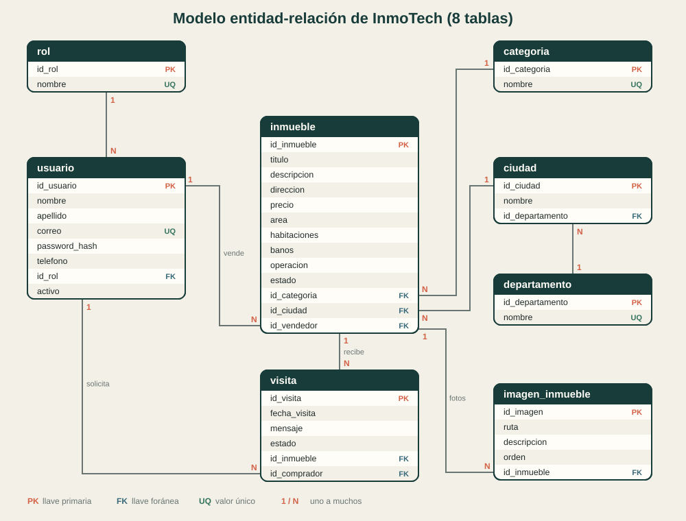
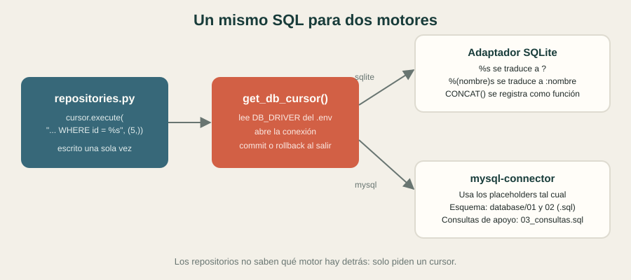

# Base de datos

Este documento explica cómo se diseñó la base de datos de InmoTech, cómo se implementó y cómo la usa la aplicación.

## Resumen

- **Motor del proyecto:** MySQL 8 (`inmotech_db`, codificación `utf8mb4`, motor `InnoDB`).
- **Motor de desarrollo:** SQLite, para poder correr el proyecto sin instalar nada.
- **7 tablas**, todas relacionadas por llaves foráneas.
- **Scripts:** `database/01_estructura.sql`, `02_datos_iniciales.sql` y `03_consultas.sql`.



## 1. Cómo se diseñó

### Paso 1: identificar las entidades

Se partió de lo que el portal necesita guardar:

| Necesidad | Entidad |
|---|---|
| Quién usa el portal (compradores, vendedores, administrador) | `usuario` y `rol` |
| Qué se publica | `inmueble` |
| De qué tipo es (casa, apartamento, lote, local) | `categoria` |
| Dónde queda | `ciudad` y `departamento` |
| Quién quiere conocerlo y cuándo | `visita` |

### Paso 2: definir las relaciones

Todas son de uno a muchos:

| Relación | Se lee como |
|---|---|
| `rol` 1 — N `usuario` | un rol lo tienen muchos usuarios |
| `usuario` 1 — N `inmueble` | un vendedor publica muchos inmuebles |
| `categoria` 1 — N `inmueble` | una categoría agrupa muchos inmuebles |
| `ciudad` 1 — N `inmueble` | en una ciudad hay muchos inmuebles |
| `departamento` 1 — N `ciudad` | un departamento tiene muchas ciudades |
| `inmueble` 1 — N `visita` | un inmueble recibe muchas visitas |
| `usuario` 1 — N `visita` | un comprador solicita muchas visitas |

`usuario` participa dos veces: como **vendedor** de un inmueble (`inmueble.id_vendedor`) y como **comprador** de una visita (`visita.id_comprador`). No se crearon tablas separadas de vendedor y comprador porque comparten los mismos datos; lo que los distingue es el rol.

### Paso 3: normalizar

El modelo está en tercera forma normal. Las decisiones concretas:

- **Ciudad y departamento en tablas aparte.** El departamento depende de la ciudad, no del inmueble. Si se guardara el nombre de ambos dentro de `inmueble`, un cambio de nombre obligaría a actualizar muchas filas y habría errores de escritura ("Bogota", "Bogotá").
- **`visita` no guarda el vendedor.** Se obtiene pasando por `inmueble`. Guardarlo dos veces permitiría que una visita apunte a un vendedor distinto al dueño del inmueble.
- **`categoria` y `rol` son tablas, `operacion` y `estado` son `ENUM`.** Las categorías y los roles son catálogos que pueden crecer sin tocar el código. En cambio `VENTA/ARRIENDO`, `DISPONIBLE/NO_DISPONIBLE` y los estados de la visita son conjuntos cerrados que el código usa para tomar decisiones, así que se dejan fijos en la propia columna.

### Paso 4: tipos de dato y restricciones

| Decisión | Razón |
|---|---|
| `precio DECIMAL(14,2)` | El dinero no se guarda en `FLOAT`: tiene errores de redondeo. 14 dígitos alcanzan para precios de inmuebles en pesos colombianos |
| `area DECIMAL(8,2)` | Metros cuadrados con dos decimales, hasta lotes grandes |
| `CHECK (precio > 0)`, `CHECK (area > 0)`, `CHECK (habitaciones >= 0)`, `CHECK (banos >= 0)` | La base rechaza datos absurdos aunque la aplicación falle |
| `correo UNIQUE` | No pueden existir dos cuentas con el mismo correo |
| `password_hash VARCHAR(255)` | Se guarda el hash, nunca la contraseña. 255 caracteres alcanzan para el formato de Werkzeug |
| `fecha_visita DATETIME` | La visita tiene fecha y hora |
| `utf8mb4` | Tildes, eñes y cualquier carácter sin problemas |

## 2. Diccionario de datos

### `rol`

| Columna | Tipo | Notas |
|---|---|---|
| `id_rol` | INT, PK, autoincremental | |
| `nombre` | VARCHAR(50), único | ADMINISTRADOR, VENDEDOR, COMPRADOR |

### `usuario`

| Columna | Tipo | Notas |
|---|---|---|
| `id_usuario` | INT, PK, autoincremental | |
| `nombre` | VARCHAR(100) | |
| `apellido` | VARCHAR(100) | |
| `correo` | VARCHAR(150), único | Se guarda en minúsculas |
| `password_hash` | VARCHAR(255) | Hash de Werkzeug (PBKDF2 en los datos de prueba; los registros nuevos usan el método por defecto de la versión instalada) |
| `telefono` | VARCHAR(20) | Texto, porque puede llevar prefijos |
| `id_rol` | INT, FK a `rol` | |

### `departamento`

| Columna | Tipo | Notas |
|---|---|---|
| `id_departamento` | INT, PK, autoincremental | |
| `nombre` | VARCHAR(100), único | |

### `ciudad`

| Columna | Tipo | Notas |
|---|---|---|
| `id_ciudad` | INT, PK, autoincremental | |
| `nombre` | VARCHAR(100) | |
| `id_departamento` | INT, FK a `departamento` | |

### `categoria`

| Columna | Tipo | Notas |
|---|---|---|
| `id_categoria` | INT, PK, autoincremental | |
| `nombre` | VARCHAR(50), único | Casa, Apartamento, Lote, Local |

### `inmueble`

| Columna | Tipo | Notas |
|---|---|---|
| `id_inmueble` | INT, PK, autoincremental | |
| `titulo` | VARCHAR(200) | |
| `descripcion` | TEXT | |
| `direccion` | VARCHAR(200) | |
| `precio` | DECIMAL(14,2) | Mayor que 0. En COP; si es arriendo, es el canon mensual |
| `area` | DECIMAL(8,2) | Mayor que 0, en m² |
| `habitaciones` | INT | 0 o más. Los lotes y locales usan 0 |
| `banos` | INT | 0 o más |
| `operacion` | ENUM('VENTA','ARRIENDO') | |
| `estado` | ENUM('DISPONIBLE','NO_DISPONIBLE') | Por defecto DISPONIBLE |
| `id_categoria` | INT, FK a `categoria` | |
| `id_ciudad` | INT, FK a `ciudad` | |
| `id_vendedor` | INT, FK a `usuario` | |

### `visita`

| Columna | Tipo | Notas |
|---|---|---|
| `id_visita` | INT, PK, autoincremental | |
| `fecha_visita` | DATETIME | Fecha y hora propuestas |
| `mensaje` | TEXT, opcional | Lo que el comprador quiere decirle al vendedor |
| `estado` | ENUM('PENDIENTE','CONFIRMADA','CANCELADA','REALIZADA') | Por defecto PENDIENTE |
| `id_inmueble` | INT, FK a `inmueble` | |
| `id_comprador` | INT, FK a `usuario` | |

## 3. Integridad referencial

Todas las llaves foráneas se declararon con:

```sql
ON UPDATE CASCADE
ON DELETE RESTRICT
```

- `ON UPDATE CASCADE`: si cambia una llave primaria, el cambio se propaga.
- `ON DELETE RESTRICT`: no se puede borrar algo que otra tabla está usando. No se puede borrar un vendedor que tiene inmuebles, ni un inmueble que tiene visitas, ni una ciudad con inmuebles. Es una protección contra borrados que dejarían datos huérfanos. Por eso el portal **no borra** inmuebles: los pausa con `estado = 'NO_DISPONIBLE'`.

Hay una regla que la base de datos **no** puede expresar con llaves foráneas: que `inmueble.id_vendedor` sea un usuario con rol VENDEDOR y que `visita.id_comprador` sea un COMPRADOR. Eso lo garantiza la aplicación (`@role_required` en las rutas y las comprobaciones de `services.py`).

## 4. Índices

Además de las llaves primarias y de las columnas `UNIQUE` (que MySQL indexa solo), se crearon índices en las columnas por las que se filtra o se une:

| Índice | Para qué |
|---|---|
| `idx_usuario_rol` | Unir `usuario` con `rol` |
| `idx_ciudad_departamento` | Listar ciudades de un departamento (el formulario de publicar) |
| `idx_inmueble_estado` | El catálogo siempre filtra `estado = 'DISPONIBLE'` |
| `idx_inmueble_ciudad`, `idx_inmueble_categoria`, `idx_inmueble_operacion`, `idx_inmueble_precio` | Filtros del catálogo |
| `idx_inmueble_vendedor` | "Mis inmuebles" |
| `idx_visita_inmueble`, `idx_visita_comprador` | Visitas de un inmueble o de un comprador |
| `idx_visita_estado`, `idx_visita_fecha` | Filtrar y ordenar visitas |

## 5. Scripts y orden de ejecución

| Script | Contenido |
|---|---|
| `database/01_estructura.sql` | Crea la base `inmotech_db`, borra las tablas si existen y las vuelve a crear con llaves, restricciones e índices |
| `database/02_datos_iniciales.sql` | Roles, 6 departamentos, 12 ciudades, 4 categorías, 5 usuarios de prueba, 8 inmuebles y 4 visitas |
| `database/03_consultas.sql` | Las consultas principales del sistema, para probarlas a mano: catálogo, catálogo con filtros, detalle, publicaciones de un vendedor, visitas de un comprador, visitas de un vendedor y estadísticas |

Importante: `01_estructura.sql` **borra** las tablas existentes. Úsalo para empezar de cero, no sobre datos reales.

Para montar la base en MySQL:

```bash
mysql -u root -p < database/01_estructura.sql
mysql -u root -p < database/02_datos_iniciales.sql
```

Y en el `.env`:

```
DB_DRIVER=mysql
DB_HOST=localhost
DB_PORT=3306
DB_USER=root
DB_PASSWORD=tu_clave
DB_NAME=inmotech_db
```

La consulta de estadísticas (la sección 7 de `03_consultas.sql`) todavía no la usa ninguna pantalla; quedó lista para el futuro panel de administración.

## 6. Cómo la usa la aplicación

### Una sola puerta: `get_db_cursor()`

Toda consulta pasa por el gestor de contexto de `app/db.py`:

```python
with get_db_cursor() as cursor:                    # lectura
    cursor.execute("SELECT ... WHERE id = %s", (id,))
    fila = cursor.fetchone()

with get_db_cursor(commit=True) as cursor:         # escritura
    cursor.execute("INSERT ...", datos)
```

Hace tres cosas por nosotros:

1. Abre la conexión con el motor indicado en `DB_DRIVER`.
2. Si pasó `commit=True` y no hubo errores, confirma la transacción.
3. Si hubo cualquier excepción, hace `rollback` y la vuelve a lanzar; y siempre cierra cursor y conexión.

Las lecturas devuelven **diccionarios** (`fila['titulo']`), que es lo que consumen las plantillas.

### El SQL vive solo en `repositories.py`

Cada entidad tiene su clase:

| Clase | Tabla(s) | Métodos principales |
|---|---|---|
| `UsuarioRepository` | `usuario`, `rol` | `find_by_correo`, `find_by_id`, `create_comprador` |
| `InmuebleRepository` | `inmueble` y sus relaciones | `find_all_disponibles`, `find_destacados`, `find_by_id`, `find_by_vendedor`, `create`, `update`, `update_estado` |
| `VisitaRepository` | `visita` | `create`, `find_by_id`, `find_by_comprador`, `find_by_vendedor`, `update_estado` |
| `UbicacionCategoriaRepository` | `departamento`, `ciudad`, `categoria` | `get_departamentos`, `get_ciudades`, `get_categorias` |

### Consultas parametrizadas

Los valores que vienen del usuario **nunca** se pegan dentro del texto SQL. Se pasan aparte, como parámetros, y el motor los trata como datos:

```python
sql = "SELECT ... FROM `usuario` u ... WHERE u.correo = %s LIMIT 1;"
cursor.execute(sql, (correo,))
```

Esto evita la inyección SQL. Si alguien escribe `' OR 1=1 --` como correo, la base de datos lo busca literalmente como un correo.

### Filtros dinámicos del catálogo

El catálogo combina hasta seis filtros opcionales. La consulta se construye agregando condiciones fijas según qué filtros llegaron; lo único que viene del usuario son los valores, que van como parámetros:

```python
sql = """SELECT ... WHERE i.estado = 'DISPONIBLE'"""
params = []

if filtros.get('id_ciudad'):
    sql += " AND i.id_ciudad = %s"
    params.append(int(filtros['id_ciudad']))

if filtros.get('precio_min'):
    sql += " AND i.precio >= %s"
    params.append(float(filtros['precio_min']))
# ... categoría, operación, precio máximo y habitaciones
```

Los valores además pasan antes por `InmuebleService.obtener_catalogo`, que los convierte a número y descarta los inválidos. El filtrado ocurre en la base de datos, no en Python, así que el catálogo escala aunque haya miles de inmuebles.

### Uniones (JOIN)

Casi todas las consultas de lectura unen varias tablas para entregar la fila lista para mostrar. Por ejemplo, el detalle de un inmueble une `inmueble` con `categoria`, `ciudad`, `departamento` y `usuario` (el vendedor):

```sql
FROM `inmueble` i
INNER JOIN `categoria` c     ON i.id_categoria = c.id_categoria
INNER JOIN `ciudad` ci       ON i.id_ciudad = ci.id_ciudad
INNER JOIN `departamento` d  ON ci.id_departamento = d.id_departamento
INNER JOIN `usuario` u       ON i.id_vendedor = u.id_usuario
```

"Mis inmuebles" usa además `LEFT JOIN` con `visita` y `COUNT(...)` con `GROUP BY`, para contar cuántas visitas tiene cada publicación, incluidas las que tienen cero.

### Escrituras

| Acción | Sentencia |
|---|---|
| Registrar comprador | `INSERT INTO usuario` con una subconsulta que busca el `id_rol` de `'COMPRADOR'`, para que el rol no dependa de un número escrito en el código |
| Publicar inmueble | `INSERT INTO inmueble` con parámetros con nombre (`%(titulo)s`) |
| Editar inmueble | `UPDATE inmueble SET ... WHERE id_inmueble = ...` |
| Pausar o reactivar | `UPDATE inmueble SET estado = ...` |
| Pedir una visita | `INSERT INTO visita` con estado `PENDIENTE` |
| Cambiar el estado de una visita | `UPDATE visita SET estado = ...` |

Las reglas que deciden **si** se puede hacer una escritura (dueño, fecha futura, transición válida) están en `services.py`, antes de llegar al repositorio. La base de datos es la última barrera, con sus `CHECK`, `UNIQUE` y llaves foráneas.

## 7. Dos motores con el mismo código



Para desarrollar no queremos obligar a instalar y configurar MySQL, así que `app/db.py` también sabe hablar con SQLite. El truco es que los repositorios escriben el SQL con la sintaxis de MySQL y el adaptador lo traduce:

| MySQL | SQLite | Cómo se resuelve |
|---|---|---|
| `%s` | `?` | `SQLiteCursor.execute` reemplaza los placeholders |
| `%(nombre)s` | `:nombre` | Ídem |
| `CONCAT(a, ' ', b)` | no existe | Se registra una función `CONCAT` al abrir la conexión |
| `AUTO_INCREMENT` | `INTEGER PRIMARY KEY` | Está en el esquema propio de SQLite |
| `ENUM(...)` | `TEXT` con `CHECK (col IN (...))` | Ídem |
| `DECIMAL` | `NUMERIC` | Ídem |
| Llaves foráneas siempre activas | Hay que activarlas | `PRAGMA foreign_keys = ON` en cada conexión |
| Resultados como diccionario | `sqlite3.Row` | Se convierte con `dict(fila)` |

El esquema de SQLite vive en `database/sqlite/`:

- `01_estructura.sql` usa `CREATE TABLE IF NOT EXISTS`, así que se puede ejecutar en cada arranque.
- `02_datos_iniciales.sql` solo se carga si la tabla `rol` está vacía, es decir, la primera vez.

La base queda en `instance/inmotech.sqlite3`. Si se borra ese archivo, la aplicación lo vuelve a crear con los datos de prueba. Está en el `.gitignore`.

Conviene recordar que los scripts de `database/sqlite/` y los de `database/` (MySQL) son dos copias del mismo modelo: si se cambia una tabla, hay que cambiarla en los dos lugares.

## 8. Datos de prueba

Los 5 usuarios (clave `123456`) cubren los tres roles. Los 8 inmuebles están repartidos entre 7 ciudades y las 4 categorías, y uno está `NO_DISPONIBLE` para comprobar que no aparece en el catálogo. Las 4 visitas tienen un estado distinto (pendiente, confirmada, realizada y cancelada), de modo que todas las pantallas se pueden probar de inmediato.

## 9. Limitaciones conocidas

- Se abre una conexión nueva por cada operación. Es simple y suficiente para este tamaño; con más usuarios convendría un pool de conexiones.
- La visita no impide por sí misma que dos compradores pidan el mismo horario; el vendedor decide al confirmar.
- Los dos conjuntos de scripts (MySQL y SQLite) deben mantenerse en paralelo.
