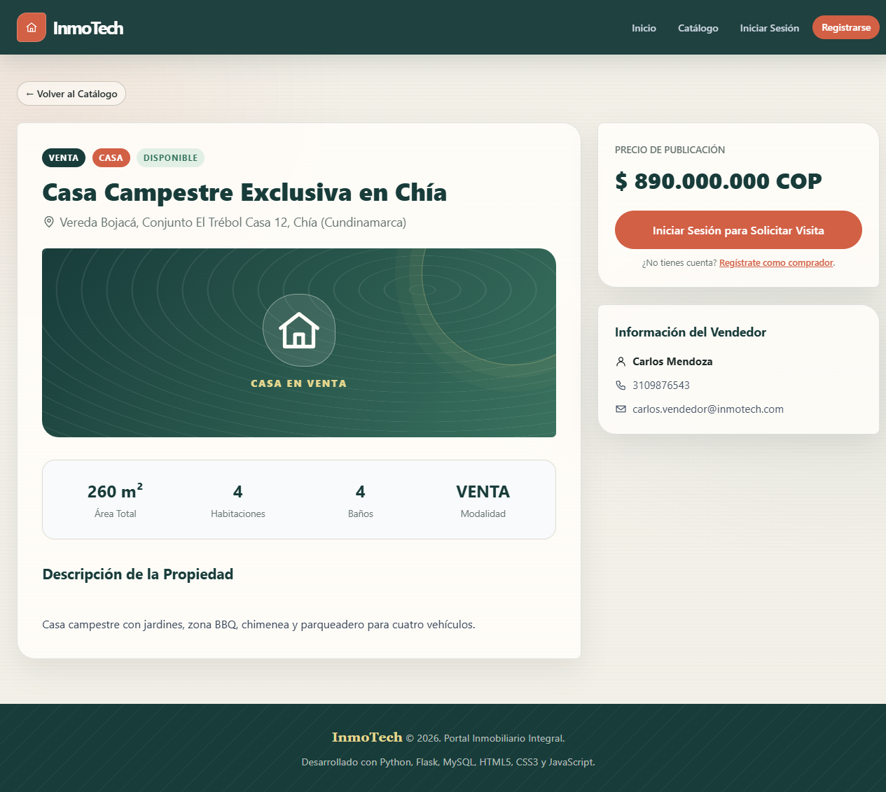
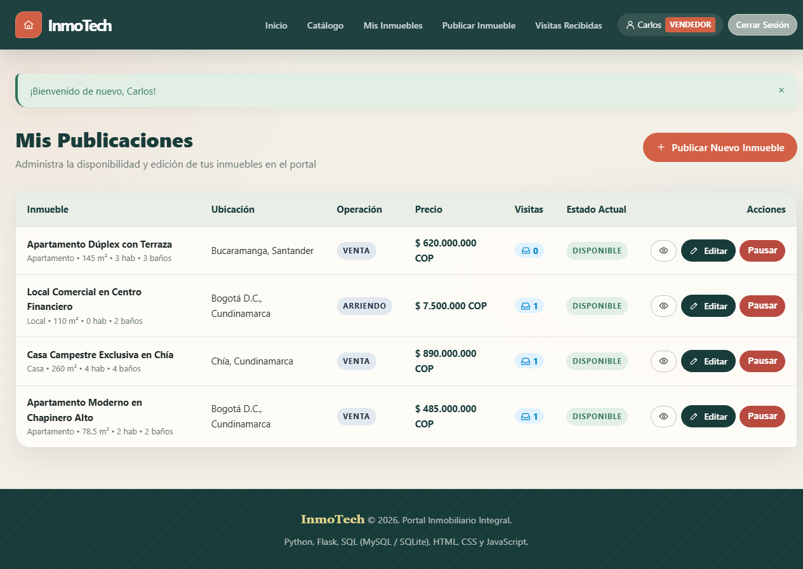
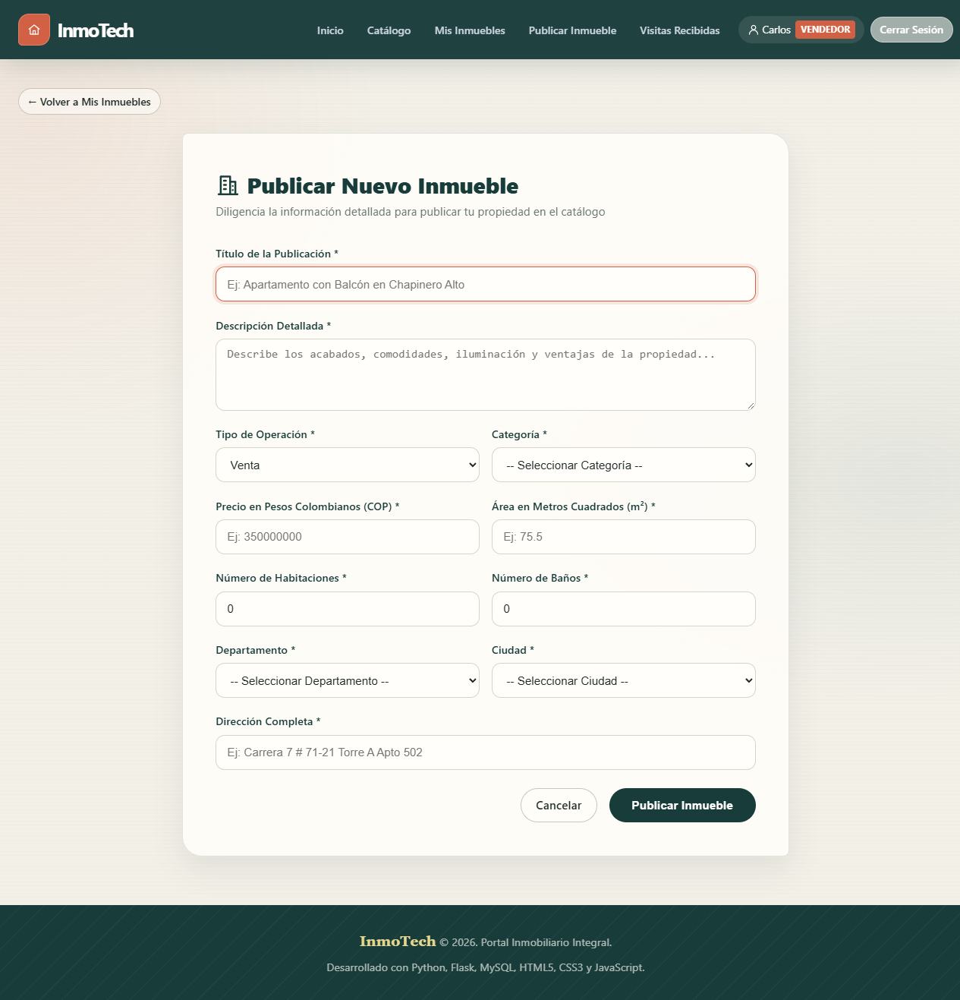
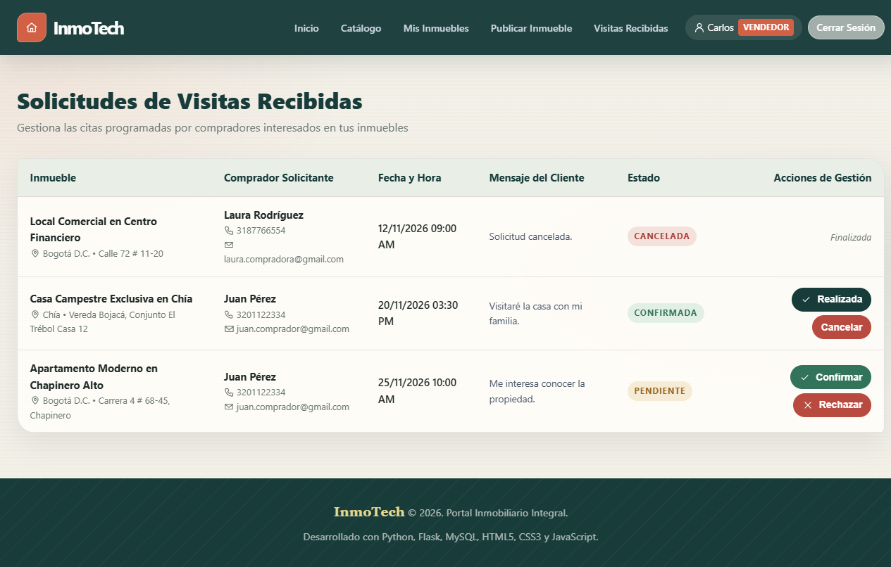
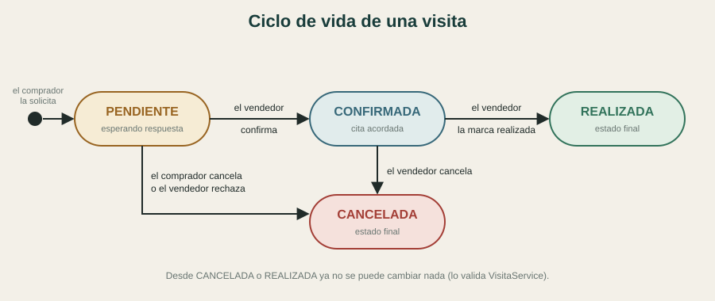

# Guía de uso

Recorrido por la aplicación según el rol. Para probarla sin registrarse usa las cuentas de prueba del [README](../README.md#cuentas-de-prueba) (clave `123456`).

## Visitante

### Inicio

Muestra las cuatro categorías y los seis inmuebles disponibles más recientes.

### Catálogo

Lista todos los inmuebles **disponibles**. Los filtros se combinan entre sí: ciudad, categoría, operación, precio mínimo y máximo, y mínimo de habitaciones. Los filtros viajan en la URL (`/catalogo?operacion=VENTA&habitaciones_min=2`), así que cualquier búsqueda se puede copiar y compartir.

### Detalle de un inmueble

Muestra descripción, ubicación, precio, área, habitaciones y baños, y los datos de contacto del vendedor. Según quién esté mirando, cambia la acción disponible:

- Comprador: botón **Agendar visita**.
- Vendedor dueño: botón **Editar**.
- Sin sesión: se invita a iniciar sesión.

### Registro e inicio de sesión

El registro crea siempre una cuenta de **comprador**. Los vendedores no se pueden registrar solos; se crean directamente en la base de datos. La contraseña debe tener mínimo 6 caracteres.

| Inicio de sesión | Registro |
|---|---|
|  |  |

Al entrar, el comprador llega al catálogo y el vendedor a su panel de inmuebles.

## Comprador

### Pedir una visita

Desde el detalle de un inmueble disponible: se elige fecha y hora (debe ser futura) y se puede dejar un mensaje para el vendedor.

### Mis visitas

Historial de solicitudes con su estado y los datos de contacto del vendedor. Mientras una solicitud esté **pendiente** se puede cancelar.

## Vendedor

### Mis inmuebles

Tabla con todas sus publicaciones, el número de visitas que ha recibido cada una y su estado. Desde aquí puede ver el detalle, editar, y **pausar** (el inmueble deja de aparecer en el catálogo) o reactivar. Los inmuebles no se borran.

### Publicar o editar un inmueble

El formulario valida título, descripción, dirección, operación, precio, área, habitaciones, baños, categoría y ciudad. La ciudad se carga según el departamento elegido, consultando `/api/ciudades/<id>` con JavaScript.

### Visitas recibidas

Lista de las solicitudes que llegaron a sus inmuebles, ordenadas por fecha. Según el estado, los botones disponibles son distintos.

## Ciclo de vida de una visita

| Estado | Quién lo provoca | Qué puede pasar después |
|---|---|---|
| PENDIENTE | El comprador al enviar la solicitud | El vendedor la confirma o la rechaza; el comprador la cancela |
| CONFIRMADA | El vendedor | El vendedor la marca realizada o la cancela |
| REALIZADA | El vendedor | Nada, es un estado final |
| CANCELADA | El comprador o el vendedor | Nada, es un estado final |

Esta regla la aplica `VisitaService` y no solo los botones de la pantalla: aunque alguien envíe la petición a mano, el servidor rechaza modificar una visita que ya está cancelada o realizada.

## Mensajes y errores

- Los avisos de éxito, error o información aparecen arriba de la página y se pueden cerrar.
- Si se intenta entrar a una pantalla de otro rol, la aplicación redirige al inicio con un aviso de acceso denegado.
- Si se intenta entrar a una pantalla protegida sin sesión, lleva al login y, al entrar, devuelve a la pantalla que se pedía.
- Las páginas 403, 404 y 500 tienen su propio mensaje.
