# Guía de uso

Recorrido por la aplicación según el rol. Para probarla sin registrarse usa las cuentas de prueba del [README](../README.md#cuentas-de-prueba) (clave `123456`).

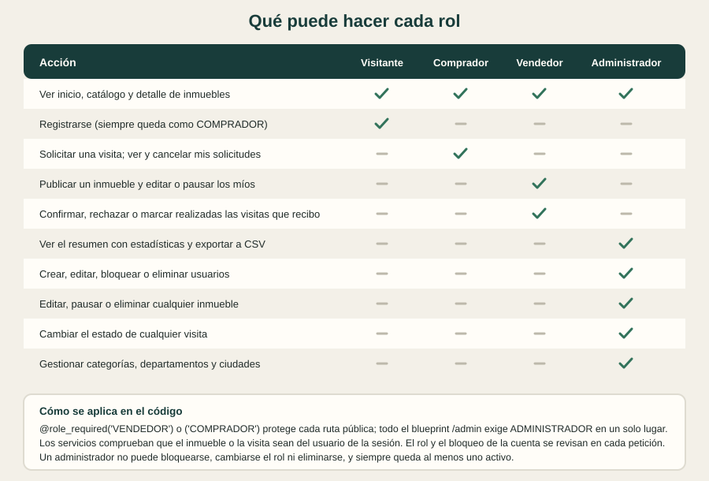

## Visitante

### Inicio

Muestra las cuatro categorías y los seis inmuebles disponibles más recientes.

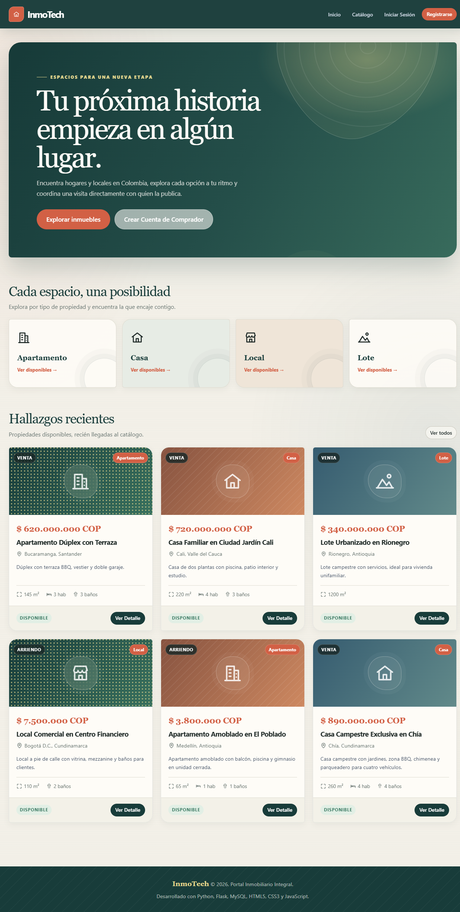

### Catálogo

Lista todos los inmuebles **disponibles**, cada uno con su foto de portada. Los filtros se combinan entre sí: ciudad, categoría, operación, precio mínimo y máximo, y mínimo de habitaciones. Los filtros viajan en la URL (`/catalogo?operacion=VENTA&habitaciones_min=2`), así que cualquier búsqueda se puede copiar y compartir.

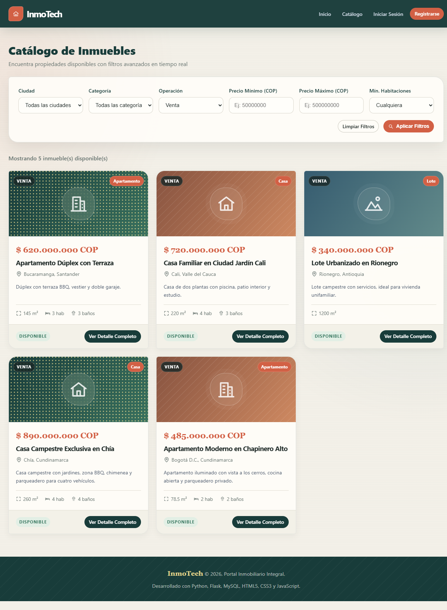

#### Vista rápida

El botón **Vista rápida** de cada tarjeta abre una ventana con el carrusel de fotos, el precio, la ubicación y la descripción, sin salir del catálogo. Desde ahí se puede pasar al detalle completo. Se cierra con **Esc**, con el botón de cerrar o haciendo clic fuera.

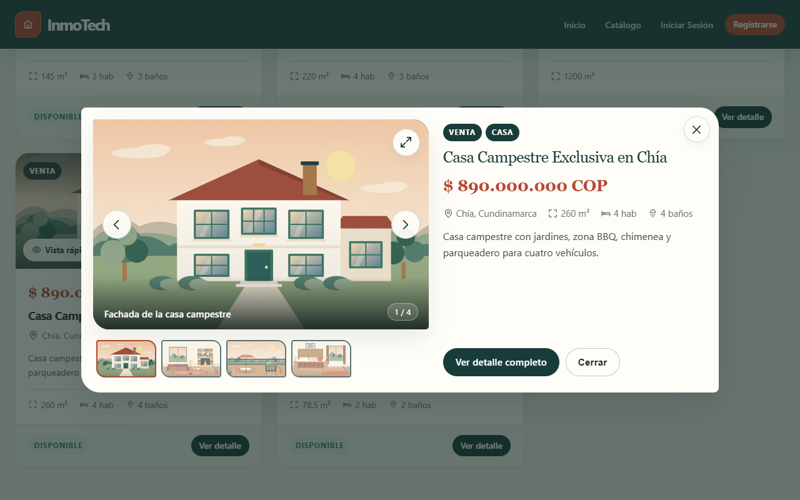

### Detalle de un inmueble

Muestra el carrusel de fotos, la descripción, la ubicación, el precio, el área, las habitaciones y los baños, y los datos de contacto del vendedor. Según quién esté mirando, cambia la acción disponible:

- Comprador: botón **Agendar visita**.
- Vendedor dueño: botón **Editar**.
- Sin sesión: se invita a iniciar sesión.

#### Carrusel de fotos

| Acción | Cómo |
|---|---|
| Cambiar de foto | Flechas, miniaturas, teclas **←** y **→**, o deslizar con el dedo |
| Ir a la primera o última | **Inicio** y **Fin** |
| Ampliar | Clic o toque en la foto, o el botón de la esquina |
| Cambiar de foto ya ampliada | Flechas o teclas **←** y **→** |
| Cerrar la vista ampliada | **Esc**, el botón de cerrar o clic en el fondo |

Cada foto tiene un texto descriptivo ("Fachada de la casa", "Sala con chimenea"...) que se muestra sobre la imagen y que leen los lectores de pantalla.

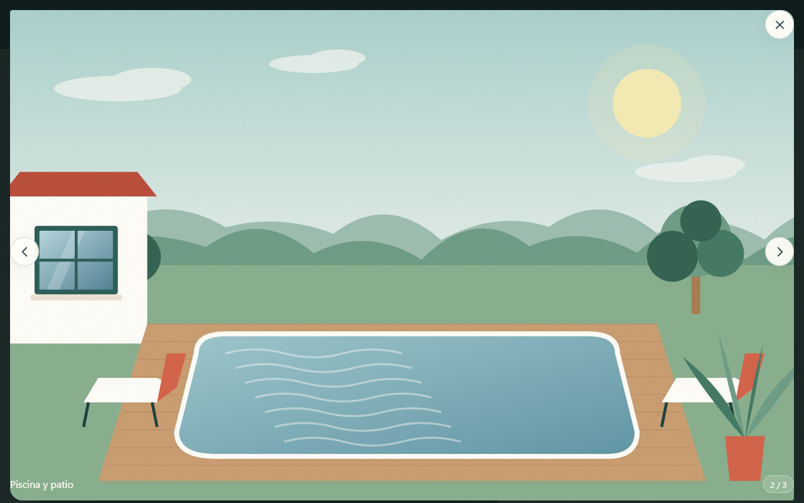

### Registro e inicio de sesión

El registro crea siempre una cuenta de **comprador**. Los vendedores no se pueden registrar solos; se crean directamente en la base de datos. La contraseña debe tener mínimo 6 caracteres.

| Inicio de sesión | Registro |
|---|---|
| 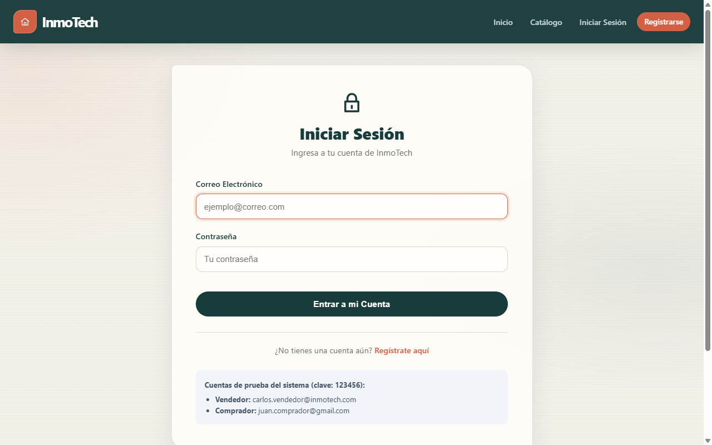 | 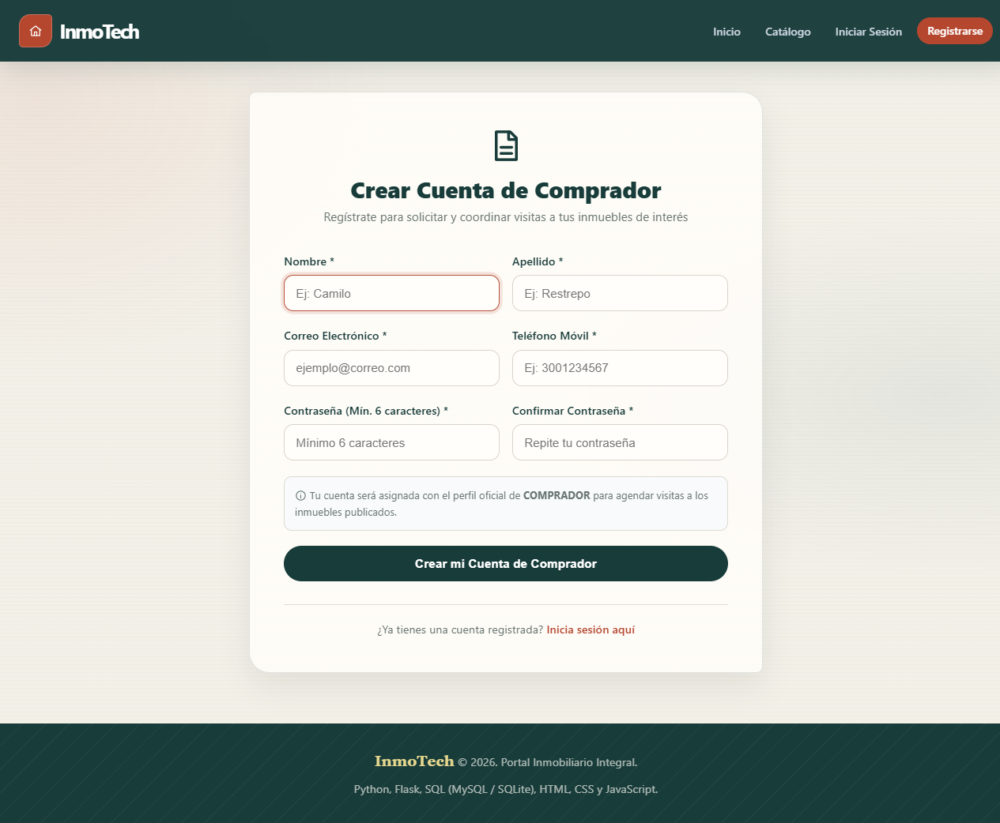 |

Al entrar, el comprador llega al catálogo y el vendedor a su panel de inmuebles.

## Comprador

### Pedir una visita

Desde el detalle de un inmueble disponible: se elige fecha y hora (debe ser futura) y se puede dejar un mensaje para el vendedor.

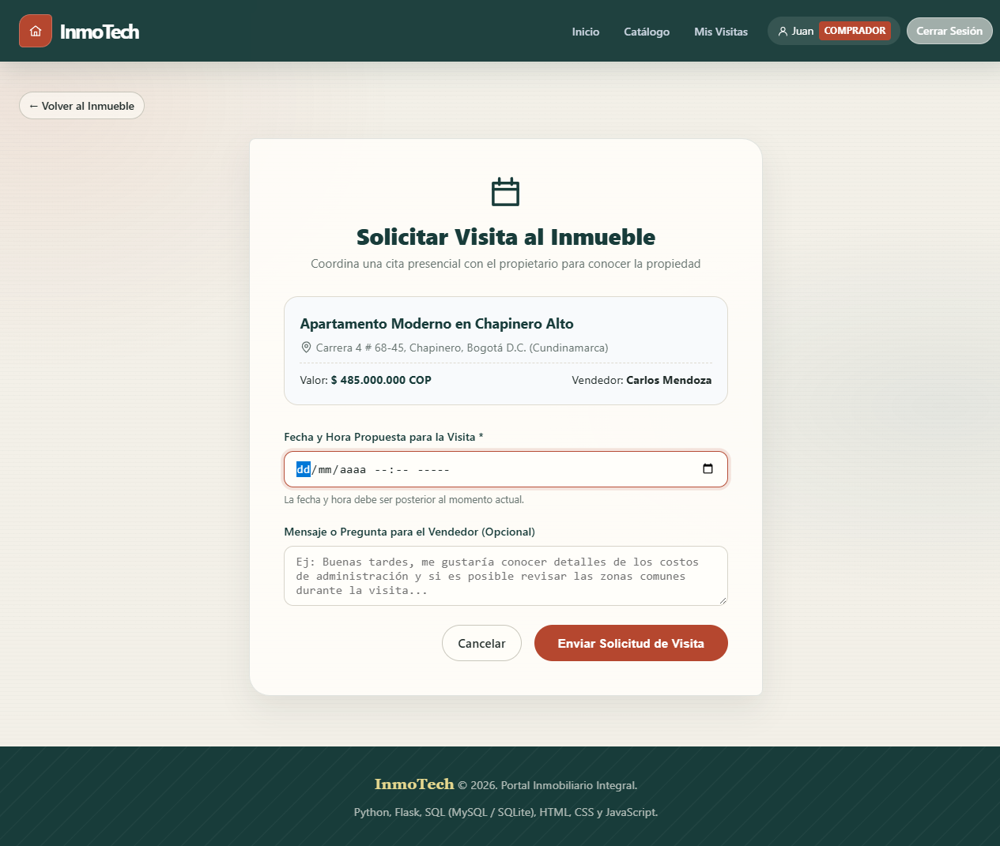

### Mis visitas

Historial de solicitudes con su estado y los datos de contacto del vendedor. Mientras una solicitud esté **pendiente** se puede cancelar.

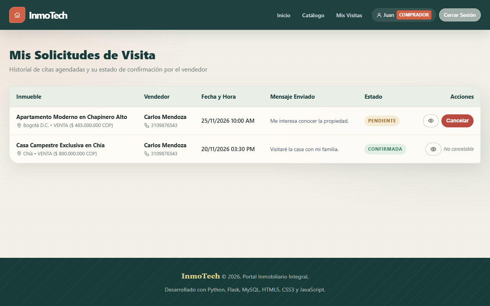

## Vendedor

### Mis inmuebles

Tabla con todas sus publicaciones, con la miniatura de portada, el número de fotos, las visitas que ha recibido cada una y su estado. Desde aquí puede ver el detalle, editar, y **pausar** (el inmueble deja de aparecer en el catálogo) o reactivar. Los inmuebles no se borran.

### Publicar o editar un inmueble

El formulario valida título, descripción, dirección, operación, precio, área, habitaciones, baños, categoría y ciudad. La ciudad se carga según el departamento elegido, consultando `/api/ciudades/<id>` con JavaScript.

Al lado del formulario hay una tarjeta de **vista previa** que muestra cómo se verá la publicación en el catálogo y se actualiza mientras se escribe: título, precio, ubicación, características y foto de portada.

#### Fotos

- Se eligen con el botón **Elegir fotos** o arrastrándolas a la zona punteada. Formatos JPG, PNG o WebP, hasta 4 MB cada una y 8 por inmueble.
- Cada foto aparece en una miniatura **antes de guardar**. Un clic la amplía; **Quitar** la descarta; **Usar de portada** la pasa al primer lugar.
- La primera foto es la portada: la que se ve en el catálogo y en el inicio.
- Si algo falla (formato, peso o cantidad) el mensaje dice cuál foto es el problema y no se guarda nada.

Al **editar** aparecen primero las fotos actuales. Se marca **Portada** en la que se quiere al frente o **Quitar** en las que sobran (se atenúan para mostrar que se van a quitar), y se pueden agregar más. Las fotos nuevas se suman al final; después de guardar se puede elegir una de ellas como portada.

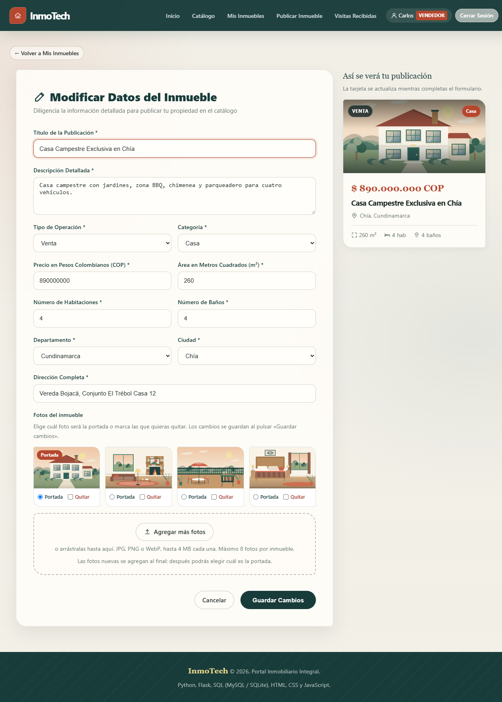

### Visitas recibidas

Lista de las solicitudes que llegaron a sus inmuebles, ordenadas por fecha. Según el estado, los botones disponibles son distintos.

## Administrador

Entra con `admin@inmotech.com` (clave `123456` en los datos de prueba). Al iniciar sesión va directo al panel; el menú lateral tiene cinco secciones.

### Resumen

Las cifras del portal de un vistazo: inmuebles disponibles (la cifra principal), usuarios, visitas pendientes, inmuebles sin fotos y cuentas bloqueadas; gráficos de inmuebles por categoría y por ciudad, visitas por estado y usuarios por rol; y la actividad reciente (inmuebles más visitados, últimas visitas y últimos usuarios). Las cifras que piden atención (sin fotos, cuentas bloqueadas) se marcan en cuanto son mayores que cero.

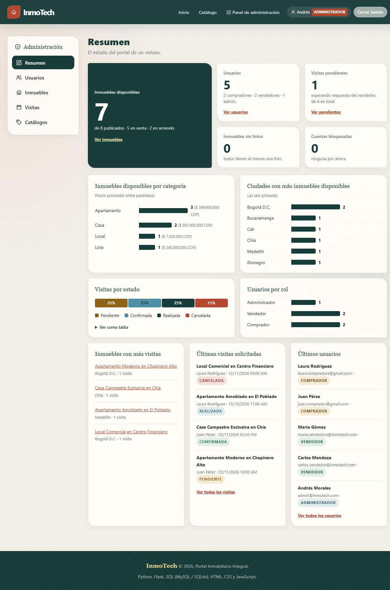

### Usuarios

Listado con búsqueda por nombre o correo y filtros por rol y por estado de la cuenta.

| Acción | Qué hace |
|---|---|
| **Nuevo usuario** | Crea una cuenta con cualquier rol, incluido vendedor o administrador (los vendedores no se pueden registrar solos) |
| **Editar** | Cambia nombre, apellido, correo, teléfono y rol |
| **Bloquear / Reactivar** | Una cuenta bloqueada no puede iniciar sesión y, si estaba conectada, se cierra en su siguiente clic. No se pierde ningún dato |
| **Restablecer contraseña** | En la pantalla de edición: escribes la nueva y se la entregas a la persona |
| **Eliminar** | Solo aparece si el usuario no tiene inmuebles ni visitas; si tiene historial, lo correcto es bloquearlo |
| **Exportar CSV** | Descarga el listado con los filtros que estés usando |

El administrador **no puede** bloquearse, cambiarse el rol ni eliminarse a sí mismo, y el sistema siempre conserva al menos un administrador activo.

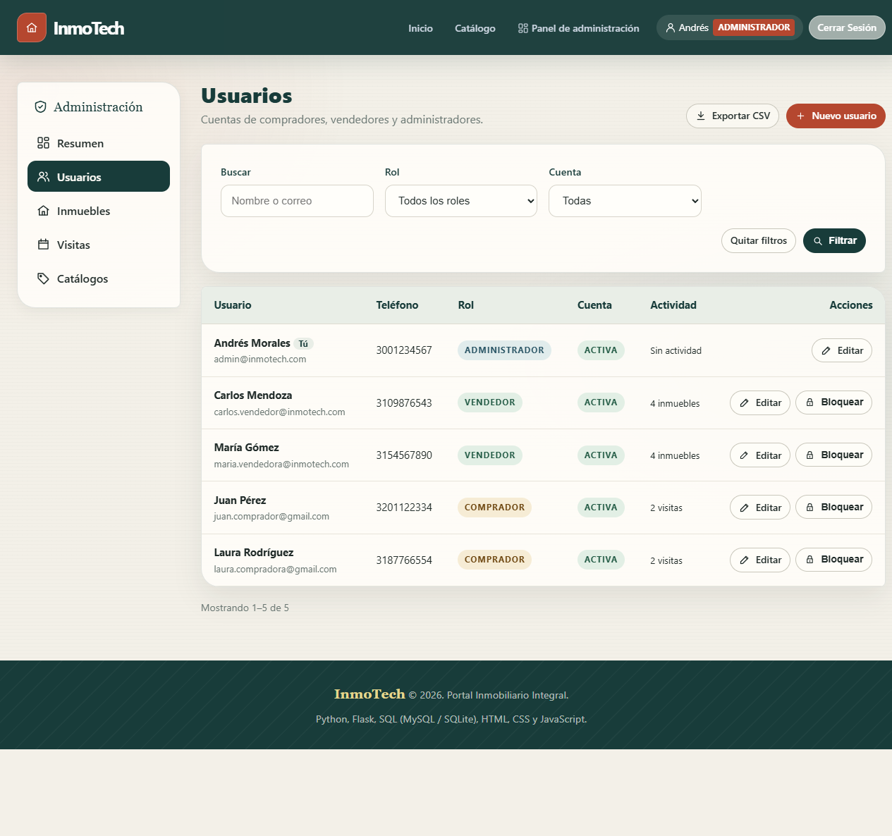

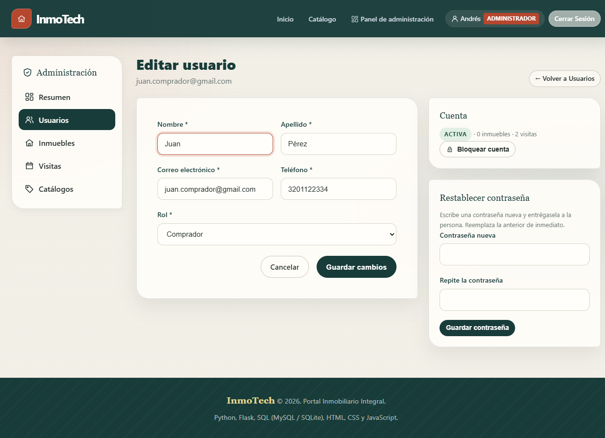

### Inmuebles

Todas las publicaciones, de cualquier vendedor, con filtros por texto, estado, operación, categoría, ciudad y vendedor. Se puede **editar** cualquiera (con el mismo formulario y las mismas fotos del vendedor), **pausarlo o publicarlo** y **eliminarlo** si no tiene visitas. También exporta a CSV.

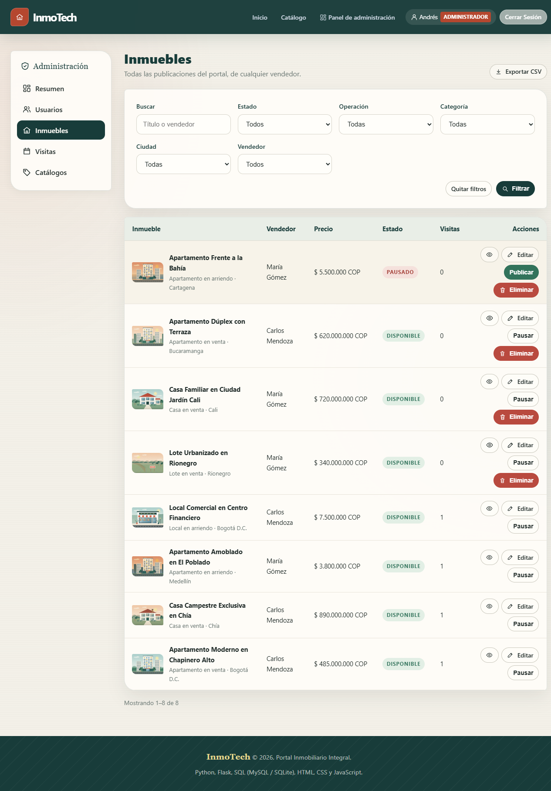

### Visitas

Todas las solicitudes, con filtros por texto, estado y rango de fechas. En cada fila hay un selector para **cambiar el estado** a cualquiera de los cuatro, útil para corregir una visita que el vendedor dejó sin cerrar. Se puede exportar a CSV.

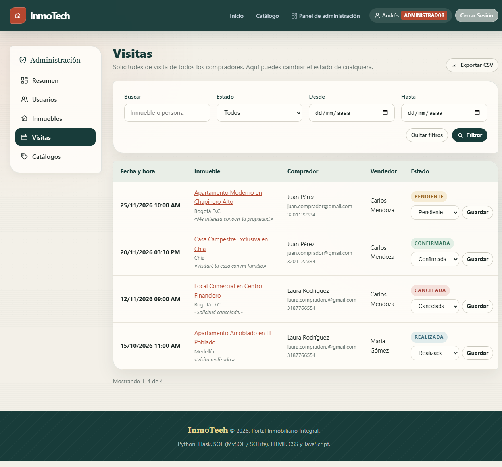

### Catálogos

Las listas que alimentan los formularios: categorías de inmueble, departamentos y ciudades. Se puede **agregar**, **renombrar** y **eliminar**. Un elemento que está en uso (una categoría con inmuebles, un departamento con ciudades) no se puede eliminar y muestra "En uso".

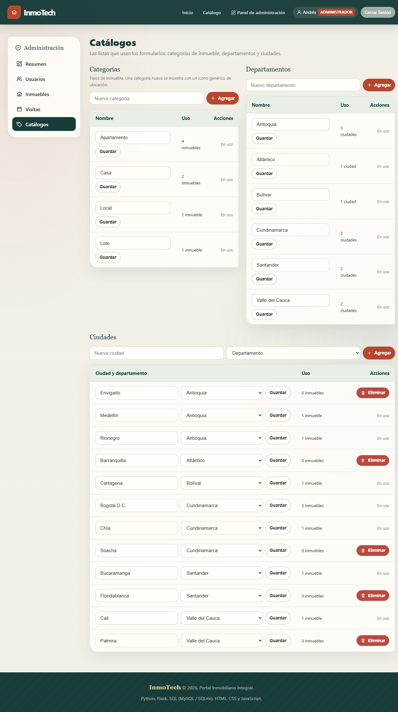

## Ciclo de vida de una visita

| Estado | Quién lo provoca | Qué puede pasar después |
|---|---|---|
| PENDIENTE | El comprador al enviar la solicitud | El vendedor la confirma o la rechaza; el comprador la cancela |
| CONFIRMADA | El vendedor | El vendedor la marca realizada o la cancela |
| REALIZADA | El vendedor | Nada, es un estado final |
| CANCELADA | El comprador o el vendedor | Nada, es un estado final |

Esta regla la aplica `VisitaService` y no solo los botones de la pantalla: aunque alguien envíe la petición a mano, el servidor rechaza modificar una visita que ya está cancelada o realizada.

## Mensajes y errores

- Los avisos de éxito, error o información aparecen arriba de la página y se pueden cerrar.
- Si se intenta entrar a una pantalla de otro rol, la aplicación redirige al inicio con un aviso de acceso denegado.
- Si se intenta entrar a una pantalla protegida sin sesión, lleva al login y, al entrar, devuelve a la pantalla que se pedía.
- Las páginas 403, 404 y 500 tienen su propio mensaje.
